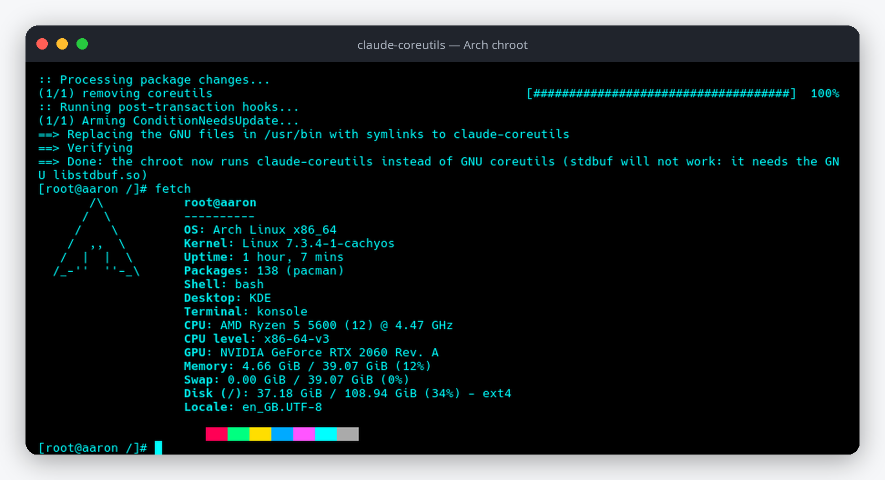

# claude-coreutils

A single multi-call binary (like busybox) that implements all 108 GNU coreutils commands plus three extras (`fetch`, `claude-chroot`, `archroot`), built for **Arch Linux and CachyOS**.

> Status: it compiles and links on CachyOS (GCC 16), and the chroot install below has been run end to end on CachyOS. It has had little other runtime testing, so expect bugs.

## Build and install

```bash
sudo pacman -S --needed base-devel cmake openssl
cmake -B build -DCMAKE_BUILD_TYPE=Release -DCU_MARCH=x86-64-v3
cmake --build build -j
sudo cmake --install build
```

Use `-DCU_NATIVE=ON` for a build tuned to your own CPU. Use `-DCU_MARCH=x86-64-v4` for AVX-512 machines.

Package it with `cd packaging && makepkg -si`.

## Use

```bash
claude-coreutils ls -lah            # run a command by name
claude-coreutils --list             # list all commands
claude-coreutils --install ~/bin    # symlink every command (use --force to replace)
claude-coreutils --uninstall ~/bin
claude-coreutils --completions fish # fish (CachyOS default), bash or zsh
claude-coreutils --arch-info        # distro, x86-64 level, btrfs layout, logind
```

When a symlink is named `ls`, `cp`, `sha256sum` and so on, the binary behaves as that command.

## Arch / CachyOS specifics

| Area | Behaviour |
|---|---|
| `cp`, `mv` | Reflink first (`FICLONE`, instant on btrfs, xfs, bcachefs, zfs), then `copy_file_range`, then read/write. |
| `shred` | Warns on copy-on-write filesystems (btrfs, zfs, bcachefs, f2fs) where overwriting in place does not work. |
| `df` | Hides pseudo filesystems. Counts btrfs/bcachefs subvolume mounts once. |
| `who`, `users`, `pinky`, `logname` | Arch has no utmp by default, so they fall back to systemd-logind sessions. |
| `arch --level` | Prints the CPU level (`x86-64-v1` to `v4`) that CachyOS repos target. |
| `uname --distro` | Prints the PRETTY_NAME from os-release. `uname -o` stays `GNU/Linux` for script compatibility. |
| `nproc` | Honours CPU affinity and the cgroup v2 `cpu.max` quota (containers). |
| `ls --color`, `dircolors` | Colours for `*.pkg.tar.zst`, `*.pkg.tar.xz` and PKGBUILD files. `dircolors` emits fish syntax when `$SHELL` is fish. |
| `chroot` | Works as the base for `arch-chroot`-style scripts. Runs `$SHELL` when no command is given. |
| `claude-chroot` | Sets up `/proc`, `/sys`, `/dev`, `/run`, `/tmp` and `resolv.conf`, then chroots. Mounts are private to the chroot and vanish when it exits. |
| `stdbuf` | Uses its own `libstdbuf.so` (built with the project, same `_STDBUF_I/O/E` contract as GNU's). Found next to the binary, in `../lib/claude-coreutils`, or in `/usr/lib/coreutils`; the chroot install puts it in `/usr/lib/coreutils`. |

## Extra commands

| Command | What it does |
|---|---|
| `fetch` | fastfetch-style summary: OS, kernel, uptime, pacman packages, shell, desktop, terminal, CPU and x86-64 level, GPU, memory, swap, disk. `--no-logo`, `--no-color`. |
| `claude-chroot [-u USER[:GROUP]] [DIR [COMMAND...]]` | Enter an Arch chroot (root only). Runs `/bin/bash` when no command is given. With no `DIR` it behaves like `archroot`: finds your Arch root or asks where it is. Installs claude-coreutils into an Arch chroot the first time. |
| `archroot [-r DIR] [COMMAND...]` | Enters your Arch chroot and installs this binary as its coreutils the first time (see below). Looks in `-r DIR`, `$ARCH_ROOT`, the saved location (`/etc/claude-coreutils/archroot`), then `./arch-root`. If none is found it offers to create a new Arch system in `./arch-root` in the current directory (runs `pacstrap`), or asks where an existing one is, and offers to remember it. |

## Install it as the coreutils of an Arch system in a folder

Entering an Arch chroot with `claude-chroot` or `archroot` installs the binary you built on the host as that system's coreutils, then enters it. Run this from the project folder:

```bash
cmake -B build -DCMAKE_BUILD_TYPE=Release && cmake --build build -j
sudo ./build/claude-coreutils claude-chroot
```

If there is no Arch root yet, it offers to create one in `./arch-root` with `pacstrap -K arch-root base openssl` (`pacstrap` comes from `arch-install-scripts`). You can also give the folder: `sudo ./build/claude-coreutils claude-chroot arch-root`.

What the install does, the first time (each step prints a `==>` line):

1. Copies the running binary to `arch-root/usr/bin/claude-coreutils` and runs `--version` inside the chroot. If it cannot run there (a missing library, for example) it stops before removing anything.
2. Runs `claude-coreutils --install /usr/local/bin` in the chroot: one symlink per command (`ls`, `cp`, `mv`, ...) pointing at the binary, which acts as whichever command it is called as. `/usr/local/bin` comes before `/usr/bin` in `PATH`, so package scripts keep working while GNU coreutils is removed.
3. Adds `IgnorePkg = coreutils` to the chroot's `pacman.conf` so upgrades do not bring it back, then runs `pacman -Rdd --noconfirm coreutils` (`-dd` because other packages depend on it).
4. Runs `claude-coreutils --install /usr/bin --force` to replace the GNU files, removes the staging links, and checks that the package is gone and the key commands link to the binary.
5. Enters the chroot (`/bin/bash`, or the command you give).

On later runs it only refreshes the binary (so a rebuilt `claude-coreutils` is picked up) and enters. A folder without `pacman` is just entered as it is.

Here it is after the install, running `fetch` from claude-coreutils inside the chroot (GNU coreutils removed):



The host's own coreutils is never touched. This has not been run as root yet.

## Commands

Run `claude-coreutils --list` for the full list with descriptions. It covers every GNU coreutils command except the SELinux-only extras, which are implemented through xattrs (`chcon`) or report that SELinux is missing (`runcon`).
